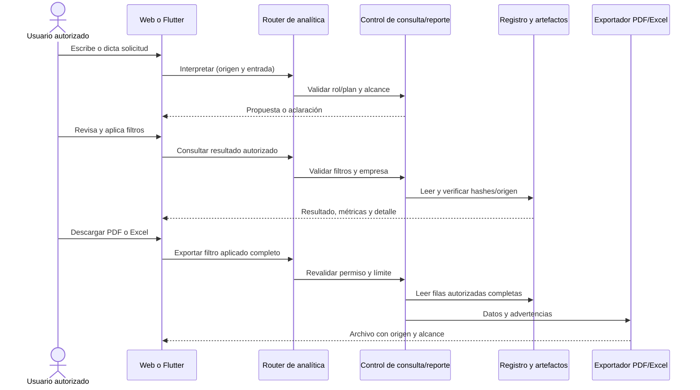

# Analítica inteligente de StyleAR

Fecha de inicio: 2026-11-08. Estado: bloques 1–6 implementados en local (datos, modelos, API, dashboard web/móvil, solicitudes y exportaciones); fuente oficial auditada con historial insuficiente. Prueba física Android completada con administrador local. Pendientes publicación autorizada y actualización del informe/UML global.

## Requerimientos y alcance

La página 6 del enunciado «Examen Parcial-2 - Sistemas 2 - S2-2026», apartados 8.4 y 8.5, exige generación de datos sintéticos, selección y preprocesamiento de variables, modelos supervisados y no supervisados entrenados, evaluación, integración, reportes y dashboard. Las páginas 5–6 también exigen reportes de lenguaje natural con datos reales, filtros, aislamiento y consultas controladas. Son requisitos complementarios: el dataset académico no sustituye los reportes comerciales reales.

Se reutilizará el módulo `inteligencia` y los reportes existentes. Los embeddings de CU23 y la interpretación de reportes no sustituyen el entrenamiento y evaluación de estos dos modelos.

| Problema | Tipo de aprendizaje | Modelo inicial propuesto | Resultado |
| --- | --- | --- | --- |
| Unidades que se venderán durante los próximos 7 días por producto y sucursal | Supervisado, regresión | Random Forest, comparado con ventas de la semana anterior | Predicción, comparación y error |
| Patrones de compra de los clientes de una empresa | No supervisado, agrupamiento | K-Means sobre indicadores RFM transformados y escalados | Grupos, características y métricas |

El objetivo supervisado es **ventas observadas**, no demanda no satisfecha. El stock puede limitar las ventas. No se prometerá predecir demanda perdida por falta de existencias.

## Bloque 1: implementación disponible

- Servicio `app/modules/inteligencia/services/analitica_datos_service.py`, independiente de PostgreSQL y de proveedores de IA.
- CLI `scripts/generar_datos_analitica.py`, sin conexiones externas, credenciales ni dependencias nuevas.
- Generación determinista por semilla y configuración; IDs con prefijo `SYN-`, origen `SINTETICO`, importes en centavos enteros BOB.
- Dataset por defecto: 420 días desde 2025-01-01, 2 empresas ficticias, 3 sucursales, 12 productos y 150 clientes por empresa.
- Variaciones por temporada, fin de semana, promoción, popularidad, sucursal y ruido. Existencias y reposiciones simuladas; incluye días con cero ventas.
- Cada ticket sintético contiene un producto. Es una simplificación documentada, no un simulador completo de carritos, cambios o devoluciones.
- Se guardan seis CSV y un manifiesto con configuración, versión, identificador, conteos, fechas de partición y SHA-256 de cada CSV.
- No se insertan ventas, clientes ni productos ficticios en las tablas comerciales. La salida predeterminada está dentro de `.private/`, ignorada por Git.
- La salida debe ser nueva; se rechaza sobrescribir una carpeta existente. Primero se prepara en una carpeta temporal y después se publica el conjunto completo.

Desde `tr-backend`, en PowerShell:

```powershell
.\.venv\Scripts\python.exe scripts/generar_datos_analitica.py
```

Otra ejecución reproducible con distinta carpeta:

```powershell
.\.venv\Scripts\python.exe scripts/generar_datos_analitica.py --semilla 20261108 --dias 420 --salida .private/analitica/repeticion_v1
```

Para consultar opciones: `--help`. Mismos parámetros y versión producen el mismo contenido; una semilla diferente genera otra realización. No cambiar la semilla para elegir artificialmente las mejores métricas.

| Archivo | Contenido |
| --- | --- |
| `productos.csv` | Empresa, producto ficticio, categoría y precio base |
| `clientes.csv` | Empresa e identificador ficticio, sin datos personales |
| `ventas.csv` | Tickets con fecha, empresa, cliente, sucursal, producto, cantidad e importe |
| `ventas_diarias.csv` | Serie diaria completa, incluidos ceros, precio, descuento y stock inicial |
| `prediccion_semanal.csv` | Variables al cierre del día y ventas de los próximos 7 días como objetivo |
| `clientes_rfm.csv` | Recencia, frecuencia y gasto en los últimos 180 días, solo clientes con compras en esa ventana |

Si se genera un historial menor de 180 días, RFM usa únicamente el historial disponible; no inventa compras anteriores. El conjunto de demostración por defecto sí contiene la ventana completa.

## Contrato del aprendizaje supervisado

Una fila representa una combinación empresa–sucursal–producto al cierre de un día. Se utiliza el total de producto, no la talla/color, para reducir la dispersión del historial inicial.

| Campo | Uso |
| --- | --- |
| `empresa_id` | Aislamiento y selección del modelo; no predictor |
| `producto_id`, `sucursal_id`, `categoria` | Variables categóricas, codificadas dentro del pipeline de entrenamiento |
| `mes` | Estacionalidad conocida al corte |
| `precio_corte_centavos`, `descuento_corte_pct` | Precio y promoción vigentes al corte; no precios futuros |
| `stock_corte` | Existencias restantes al cierre del día |
| `unidades_7d`, `unidades_28d` | Historial hasta el corte, incluido ese día |
| `dias_sin_stock_28d` | Días iniciados sin stock durante el historial |
| `objetivo_unidades_7d` | Variable que debe aprender a predecir; nunca se incluye como entrada |
| `fecha_corte`, `objetivo_desde`, `objetivo_hasta`, `particion`, `origen` | Trazabilidad y validación; no entradas directas al modelo |

Los cortes se separan por siete días. El objetivo empieza al día siguiente del corte y termina siete días después. Las ventanas objetivo no se solapan. Se reparten los cortes cronológicamente en 70% entrenamiento, 15% validación y el resto prueba; todas las series usan las mismas fechas de división. No se mezclan aleatoriamente filas de fechas distintas.

En el bloque 2 se ajustará todo preprocesamiento exclusivamente con entrenamiento, se elegirán hiperparámetros con validación y se consultará prueba al cerrar la selección. La evaluación usará MAE y RMSE en unidades por semana, comparadas con la referencia `unidades_7d`. Se reportará también resultado por empresa y sucursal. No se promete un porcentaje de precisión antes de entrenar.

## Contrato del aprendizaje no supervisado

RFM utiliza una fecha de corte y una ventana de hasta 180 días:

- Recencia: días desde la compra más reciente de la ventana.
- Frecuencia: cantidad de tickets distintos de la ventana.
- Gasto: suma de importes de esos tickets en centavos.

`cliente_id` y `empresa_id` identifican y aíslan resultados; no se usan como variables numéricas. No se genera una etiqueta «cliente VIP» ni un segmento objetivo. Los clientes sin compras se presentan aparte, sin forzarlos a un cluster.

En el bloque 3 se evaluará `log1p` y estandarización de RFM antes de K-Means. Se probarán varias cantidades de grupos cuando el número de clientes distintos lo permita. Se reportarán silhouette, tamaños de grupos, perfiles y estabilidad entre semillas. Un cluster no tiene una «exactitud» de clasificación. Sus nombres se asignarán después de observar sus indicadores; no se garantizará que siempre existan tres o cuatro grupos.

## Integración prevista y aislamiento

- Un pipeline y artefactos separados por empresa, versión de modelo y origen del dataset. No se mezclan historiales comerciales de distintas empresas.
- El entrenamiento se ejecutará mediante tarea explícita, no dentro de cada consulta de dashboard. Guardará parámetros, variables, fechas, hash del dataset, métricas y versión de dependencias.
- Los endpoints futuros derivarán la empresa de la sesión autenticada. Se reutilizarán las restricciones de Reportes: administrador de empresa y encargado limitado a su sucursal para predicciones. Los segmentos de clientes serán inicialmente exclusivos del administrador de empresa.
- El administrador SaaS podrá ver estado técnico del módulo, sin acceder a compras ni perfiles de empresas ajenas.
- Web y Flutter consumirán los mismos resultados del backend; no entrenarán en el dispositivo ni recibirán archivos ejecutables del modelo.
- El dashboard distinguirá «Demostración con datos sintéticos», «Resultados con historial real» e «Historial insuficiente». No se etiquetará una regla de respaldo como una predicción entrenada.
- Se utilizará una capa de extracción autorizada para los datos reales en un bloque posterior, con ventas confirmadas, exclusión de cancelaciones y criterio explícito de devoluciones. No se copiará el generador sintético a tablas reales.
- El intérprete de lenguaje natural solo podrá solicitar operaciones registradas y filtros validados. No ejecutará SQL libre ni cargará modelos aportados por usuarios.

Ejemplos futuros: «Predice las ventas de la próxima semana en mi sucursal» y «Muéstrame los grupos de clientes de mi empresa». Las predicciones son estimaciones y no modificarán automáticamente precios, stock o pedidos de reposición.

## Casos de uso y evidencia ICONIX por completar

No se asignan números nuevos de CU hasta revisar el catálogo completo, para evitar colisiones.

1. Preparar y entrenar analítica: responsable autorizado, dataset identificado, validación, registro de versión y manejo de datos insuficientes.
2. Consultar predicción de ventas: filtros permitidos, aislamiento, resultado estimado, horizonte, modelo y advertencias.
3. Consultar segmentación: administrador de empresa, perfiles agregados y ausencia de datos suficientes.
4. Generar reporte inteligente: solicitud escrita/voz, interpretación validada, consulta de resultados existentes, tabla/gráfico y exportación.

Para cada caso se completarán ficha, robustez, secuencia y trazabilidad requisito → servicio → API → pantalla → prueba cuando se implemente el bloque correspondiente. Este documento define el diseño del primer bloque; no afirma que las pantallas o los modelos ya existan.

## Orden de los siguientes bloques

1. **Disponible:** generación, contratos de datos y pruebas de integridad/reproducibilidad.
2. **Disponible en demostración sintética:** entrenamiento supervisado, referencia, evaluación temporal y artefactos. Entrenamiento oficial pendiente de exportación autorizada.
3. **Disponible en demostración sintética:** entrenamiento no supervisado, perfiles y evaluación.
4. **Disponible en local:** API autorizada y registro de artefactos persistidos. El origen oficial expone su auditoría de historial insuficiente; extracción/entrenamiento oficial pendientes de disponer de historial suficiente.
5. **Disponible en local:** dashboard web/móvil, gráficos, filtros y métricas; solicitudes y exportaciones completadas en el bloque 6.
6. **Disponible en local:** exportaciones, solicitudes naturales con vista previa, trazabilidad de extensión CU22 y validación integral automatizada. Pendientes prueba física Android y traslado de modelos/configuración al despliegue si se autoriza.

No hacen falta Firebase, Stripe, Cloudflare ni una API de IA para generar estos datos. El bloque 2 incorpora dependencias opcionales de entrenamiento fijadas en `requirements-ml.txt`, verificadas en Python 3.12. No se modifica `requirements.txt` ni se activa entrenamiento automático en el servidor desplegado.


## Validación ejecutada del bloque 1

Comando: `.\.venv\Scripts\python.exe -m pytest tests/test_analitica_datos.py -q --tb=short -p no:cacheprovider --basetemp .private/pytest_analitica_bloque1`.

Resultado: **4 pruebas aprobadas**. Comprueban reproducibilidad y hashes, reconstrucción de variables/objetivo desde la serie diaria, orden temporal sin solapamientos entre objetivos de particiones, consistencia de tickets/importes/stock/RFM, referencias de empresa y rechazo de sobrescritura o configuración inválida.

Se generó el dataset predeterminado `3b13bb5927cb7c82` en `.private/analitica/dataset_v1`: 24 productos, 300 clientes, 49.857 tickets, 30.240 filas diarias, 4.032 muestras supervisadas y 299 perfiles RFM. Un cliente no tuvo compras en la ventana y no se fuerza dentro de la segmentación. Se pueden consultar configuración, fechas, conteos y hashes en `manifiesto.json`.

Estas verificaciones validan el conjunto y su preparación. Aún no hay entrenamiento ni métricas de modelos; corresponden a los próximos bloques.


## Bloque 2: entrenamiento supervisado disponible

Servicio: `app/modules/inteligencia/services/analitica_entrenamiento_service.py`. CLI: `scripts/entrenar_prediccion_ventas.py`.

```powershell
.\.venv\Scripts\python.exe -m pip install -r requirements-ml.txt
.\.venv\Scripts\python.exe scripts/entrenar_prediccion_ventas.py --dataset .private/analitica/dataset_v1 --empresa SYN-E01 --salida .private/analitica/modelos/sintetico_e01_v1
```

La carpeta de salida debe ser nueva. El entrenamiento selecciona explícitamente una empresa, comprueba el hash del CSV, origen, fechas, horizonte de siete días, datos finitos no negativos, duplicados y separación temporal. Requiere al menos 8 fechas de corte de entrenamiento y 2 en cada partición de validación/prueba; es una condición técnica mínima, no una garantía de calidad comercial.

Se usa un pipeline de codificación categórica y Random Forest. Se comparan cuatro configuraciones (profundidad 6 o sin límite; mínimo 2 o 5 muestras por hoja), cada una con 120 árboles y semilla fija. El codificador y los modelos solo se ajustan con entrenamiento. Se elige por MAE de validación. La prueba se evalúa después de elegir; no se vuelve a ajustar el modelo con validación ni prueba. La referencia predice que la siguiente semana venderá tantas unidades como los últimos siete días.

Artefactos por ejecución:

- `modelo.joblib`: pipeline propio entrenado; solo se debe cargar desde almacenamiento de confianza. No existe carga de modelos de usuarios ni endpoint público de entrenamiento.
- `evaluacion.json`: empresa, origen, dataset y hashes, fechas, variables, versiones de Python/dependencias, candidatos, selección, métricas globales y por sucursal, y advertencia de alcance.
- `predicciones_prueba.csv`: valores observados, predichos y de referencia con producto, sucursal y fecha, limitados a la empresa seleccionada.

No se publica ni se activa automáticamente ningún modelo. Un modelo puede resultar peor que la referencia y esa diferencia también se conservará en el reporte, sin ocultarla ni cambiar la semilla buscando una mejora.

### Ensayo realizado: únicamente datos sintéticos

Empresa ficticia `SYN-E01`, dataset `3b13bb5927cb7c82`, 324 muestras de prueba:

| Métrica en unidades por producto/sucursal/semana | Random Forest | Referencia |
| --- | --- | --- |
| MAE | 4,470 | 5,565 |
| RMSE | 5,785 | 7,542 |

Un MAE de 4,470 significa un error absoluto promedio de aproximadamente 4,47 unidades en esas muestras de prueba sintéticas. No significa 95% de precisión ni demuestra rendimiento sobre la web oficial.

Selección: profundidad 6, mínimo 5 muestras por hoja, 120 árboles. Versiones y precisión completa disponibles en `.private/analitica/modelos/sintetico_e01_v1/evaluacion.json`.

Validación: **8 pruebas aprobadas** entre datos y entrenamiento. Incluyen selección por validación, referencia reconstruida, serialización/recarga del artefacto propio, aislamiento de empresa tanto en filas como en categorías aprendidas, bloqueo por hash alterado, historial insuficiente, fuga temporal, valores no finitos y origen oficial sin trazabilidad.

## Fuente oficial: decisión y pendientes

La referencia comercial oficial es el despliegue. El usuario obtuvo acceso administrativo a Railway y guardó su conexión en `.private/analitica-oficial.env`, separado de `.env` y excluido de Git. Los entrenamientos de demostración no utilizan la BD local ni la oficial. La base oficial se consultó posteriormente solo para auditar su cobertura y calidad.

La conexión oficial ya se verificó por PostgreSQL con SSL, transacción `REPEATABLE READ READ ONLY`, tiempos máximos de consulta/bloqueo y cierre con rollback. Se confirmó `transaction_read_only=on`. Todas las consultas comerciales se limitaron a la empresa de código `stylear`; no se consultaron nombres de clientes, correos, teléfonos ni datos bancarios. No se ejecutaron migraciones, correcciones comerciales o entrenamiento sobre producción.

Antes de generar el dataset oficial se verificará:

1. Empresa y sucursal autorizadas, período, zona horaria y cobertura del historial, incluidas paginación y posibles límites de exportación.
2. Detalle de venta por producto, fecha y cantidad; importe y estado confirmado. Un reporte agregado de totales no basta para construir la serie por producto/sucursal.
3. Identificación de ventas de ensayo y canceladas, para distinguirlas del historial comercial. El objetivo inicial es unidades de ventas confirmadas; las devoluciones no se convertirán silenciosamente en cantidades negativas. El tratamiento de devoluciones y cambios se documentará según los registros disponibles antes de construir el conjunto oficial.
4. Disponibilidad de precios, descuentos y existencias **históricos**. Los valores actuales del catálogo/inventario no se usarán como si fueran los vigentes meses atrás. Si esos datos no existen, habrá que preparar una versión del contrato/modelo con variables históricas realmente disponibles y volver a entrenar; no rellenarlas con datos sintéticos.
5. Procedencia de la exportación y control de integridad, sin almacenar contraseñas, tokens, nombres, correos o teléfonos en las muestras del modelo de ventas.

El contrato contempla origen `OFICIAL` con `fuente.referencia_exportacion`, además de hashes y empresa; el importador desde la exportación aún no está implementado. Cambiar una etiqueta del manifiesto no convierte datos sintéticos en datos oficiales. Los modelos oficiales se entrenarán de nuevo desde sus propias muestras, separados de los de demostración.

Los requerimientos académicos de datos sintéticos siguen cubiertos por el primer conjunto. Las predicciones útiles para la operación y los reportes comerciales se evaluarán con datos oficiales. Si el historial oficial es insuficiente se mostrará esa situación y se conservará la demostración académica claramente identificada.


## Auditoría oficial realizada y decisión de datos (2026-11-08)

Empresa: StyleAR, código `stylear`. El usuario confirmó que este es todo el historial disponible y que no cuenta con ventas históricas adicionales.

| Indicador | Resultado |
| --- | --- |
| Ventas completadas registradas | 8 |
| Días distintos con ventas completadas | 3 |
| Clientes distintos con ventas completadas | 1 |
| Ventas con señal explícita de pago de prueba | 4 |
| Ventas completadas sin líneas de detalle | 2 |
| Candidatas con detalle y sin señal explícita de prueba | 4 |
| Clientes distintos de esas candidatas | 1 |
| Primer y último día de esas candidatas (America/La_Paz) | 2026-09-21 a 2026-09-29 |
| Catálogo oficial | 11 productos, 2 sucursales, 3 clientes registrados |

Las exclusiones por prueba y por falta de detalle pueden solaparse: sus conteos no se suman. Los pagos conservan modo `LEGADO`; la falta de una señal explícita de prueba no certifica que las cuatro candidatas sean ventas reales. Las referencias de prueba se inspeccionaron únicamente para producir conteos; no se mostraron ni exportaron sus valores.

La revisión inicial de 8 ventas y 7 líneas sugirió una venta sin detalle. La consulta específica `NOT EXISTS` confirmó **2** ventas sin detalle: algunas ventas tienen más de una línea. El conteo definitivo es el de la tabla anterior. No se modificaron esas ventas.

**Decisión:** no entrenar ni publicar modelos oficiales con este historial. La predicción semanal carece de cobertura para separar entrenamiento/validación/prueba y la segmentación carece de clientes compradores distintos. No se alargará artificialmente la observación asumiendo que los días posteriores a la última venta son ceros válidos de operación; tampoco se copiarán ventas sintéticas al despliegue para aparentar historial.

Se mantendrán dos vías explícitas:

1. **Operación comercial:** reportes con datos oficiales y estado «Historial insuficiente» para los modelos que aún no puedan validarse. Los 3 clientes registrados no equivalen a 3 clientes con historial de compra.
2. **Demostración académica:** entrenamiento y evaluación supervisada/no supervisada en el dataset sintético separado. Sus métricas se mostrarán como sintéticas. Esto cubre la exigencia de generación de datos del enunciado sin atribuir precisión oficial a los modelos.

Ambos modelos, supervisado y no supervisado, están disponibles solo en la segunda vía. Su API local ya está implementada; las pantallas aún están pendientes. Cuando exista historial oficial suficiente se podrá preparar su exportación autorizada, revisar las variables realmente observables y entrenar de nuevo, sin reutilizar como oficial un modelo sintético.

Resultados agregados guardados localmente en `.private/analitica/auditoria_oficial_resumen.json` y `.private/analitica/estado_fuente_oficial.json`. El estado guardado es evidencia local de esta auditoría, no un endpoint ni un dashboard ya desplegado. La estructura observada está en `.private/analitica/auditoria_oficial_estructura.json`. Ninguno de esos archivos contiene la URL de conexión o contraseñas.


## Bloque 3: segmentación no supervisada disponible

Servicio: `app/modules/inteligencia/services/analitica_segmentacion_service.py`. CLI: `scripts/entrenar_segmentacion_clientes.py`. Reutiliza las dependencias de `requirements-ml.txt`; no requiere APIs externas ni acceso a PostgreSQL.

```powershell
.\.venv\Scripts\python.exe scripts/entrenar_segmentacion_clientes.py --dataset .private/analitica/dataset_v1 --empresa SYN-E01 --salida .private/analitica/modelos/segmentacion_sintetica_e01_v1
```

La salida debe ser nueva. La ejecución verifica hashes del catálogo de clientes y de RFM, origen, pertenencia y unicidad de clientes, fecha de corte/ventana comunes, números finitos no negativos y compras dentro de la ventana. Solo utiliza los tres indicadores RFM, sin incorporar IDs como variables ni mezclar empresas.

Preprocesamiento: `log1p` y `StandardScaler`, seguidos de K-Means con 20 inicializaciones y semilla fija. Se prueban entre 2 y 6 grupos, limitando el máximo por cantidad de clientes y perfiles distintos. Se exigen al menos 10 clientes con compras y 3 perfiles distintos para intentar evaluar el agrupamiento. Las configuraciones que dejan grupos con menos de 3 clientes se descartan. Si no queda ninguna configuración evaluable se informa que no hay grupos utilizables, en lugar de inventar segmentos. Estos mínimos son controles técnicos iniciales, no garantías de calidad comercial.

Se selecciona la configuración elegible con mayor silhouette. Para conjuntos mayores de 2.000 perfiles, silhouette se estima con una muestra reproducible de hasta 2.000. Se conserva el tamaño de cada grupo y la inercia de cada candidato elegible. Se comparan otras dos semillas mediante ARI contra la agrupación elegida. Las ejecuciones se limitan a un hilo de cálculo.

**Alcance de evaluación:** silhouette es una medida interna calculada sobre la instantánea transformada utilizada para agrupar; no es exactitud contra etiquetas reales ni una evaluación sobre clientes futuros. ARI aquí compara las asignaciones de distintas semillas sobre los mismos perfiles, sin convertirlas en etiquetas verdaderas. Tampoco garantiza estabilidad temporal. Referencias: [silhouette en scikit-learn](https://scikit-learn.org/stable/modules/generated/sklearn.metrics.silhouette_score.html) y [evaluación de clustering](https://scikit-learn.org/stable/modules/clustering.html).

Los grupos visibles se numeran por gasto medio descendente, con nombre neutral «Grupo 1», «Grupo 2», etc. Sus descripciones muestran recencia, frecuencia y gasto observados. No se asignan categorías como «VIP», «fiel» o «perdido» sin una definición comercial adicional. Los identificadores de cluster pueden variar entre versiones y no representan una identidad permanente del cliente.

Artefactos por empresa y ejecución:

- `modelo.joblib`: pipeline propio completo, con transformación, escalador y agrupamiento. Solo se carga desde almacenamiento de confianza.
- `evaluacion.json`: origen, empresa, hashes del dataset/modelo, fecha de corte, ventana, versiones, candidatos, criterio elegido, silhouette, estabilidad entre semillas, perfiles y mapa entre etiquetas internas y grupos visibles.
- `asignaciones.csv`: cliente ficticio, empresa, origen, fecha de corte, grupo e indicadores RFM. No contiene nombres, correo, teléfono ni datos bancarios.

Los perfiles para el futuro dashboard incluyen tamaño/proporción, medias y medianas de recencia, frecuencia y gasto, además de una descripción legible. Los clientes sin compras en la ventana se cuentan aparte y no se fuerzan dentro de un grupo.

### Ensayos sintéticos ejecutados

Dataset `3b13bb5927cb7c82`:

| Empresa ficticia | Clientes analizados | Sin compras en ventana | Grupos elegidos | Tamaños | Silhouette | ARI medio entre semillas |
| --- | --- | --- | --- | --- | --- | --- |
| SYN-E01 | 149 | 1 | 2 | 86 / 63 | 0,453 | 1,000 |
| SYN-E02 | 150 | 0 | 2 | 81 / 69 | 0,493 | 1,000 |

Se generaron ambas segmentaciones en `.private/analitica/modelos/segmentacion_sintetica_e01_v1` y `segmentacion_sintetica_e02_v1`. El resultado no describe a los clientes oficiales de StyleAR.

Para dejar las dos empresas de demostración con resultados completos, también se ejecutó la predicción supervisada de SYN-E02 en `.private/analitica/modelos/sintetico_e02_v1`: MAE 3,758 contra referencia 4,840. Sigue siendo exclusivamente una evaluación sintética; los resultados anteriores de SYN-E01 se conservaron.

Validación: **20 pruebas aprobadas** para generación, entrenamiento supervisado y segmentación. Las 12 pruebas de segmentación incluyen aislamiento del ajuste y las asignaciones por empresa, selección según evaluación, perfiles agregados, recarga del artefacto propio, reproducibilidad, rechazo de sobrescritura, hash alterado, pocos clientes, perfiles idénticos, valores no finitos/negativos, recencia fuera de ventana, fechas mezcladas, referencias ajenas, duplicados y origen oficial sin trazabilidad.

No se conectó nuevamente a la base oficial ni se modificaron sus datos durante este bloque. Su estado continúa siendo `HISTORIAL_INSUFICIENTE`. No se publica ningún modelo en producción. El siguiente bloque corresponde a la API autorizada y al acceso a estos resultados, seguido del dashboard web/móvil y los reportes/exportaciones.


## Bloque 4: API protegida y registro local de resultados

Se agregó el router `app/modules/inteligencia/router/analitica_router.py` a `app/main.py`, los filtros tipados en `schemas/reportes/analitica_request.py` y el servicio `services/analitica_consulta_service.py`. La API lee JSON/CSV ya calculados y **no importa scikit-learn/joblib, no deserializa modelos, no entrena y no abre una conexión a Railway** para atender consultas.

### Endpoints

Todos requieren una sesión activa y la función de Reportes del plan, reutilizando los controles existentes. Las respuestas correctas llevan `Cache-Control: no-store`.

| Método y ruta | Uso |
| --- | --- |
| GET `/api/v1/reportes/analitica/estado` | Fuentes oficial/demostración disponibles, alcance, sucursales autorizadas y permisos de segmentación |
| GET `/api/v1/reportes/analitica/predicciones` | Filas paginadas de evaluación histórica, métricas del filtro completo y serie agregada |
| GET `/api/v1/reportes/analitica/metricas` | Métricas de predicción y referencia para el mismo alcance/filtros |
| GET `/api/v1/reportes/analitica/segmentos` | Perfiles, métricas internas y asignaciones paginadas; solo administrador de empresa |

`origen=OFICIAL` es el valor predeterminado. **Nunca se sustituye automáticamente por demostración** cuando falta historial. En la configuración actual devuelve `HISTORIAL_INSUFICIENTE`, sin filas ni métricas de modelos oficiales. La disponibilidad oficial procede de la auditoría guardada, con fecha y fuente `AUDITORIA_RAILWAY`; no es una consulta en vivo al despliegue.

Para consultar la demostración debe indicarse `origen=DEMOSTRACION`. Los resultados llevan una advertencia explícita de datos sintéticos. La predicción publicada en este bloque es `tipo_resultado=EVALUACION_HISTORICA`: compara las predicciones del conjunto de prueba con las ventas observadas y la referencia de semana anterior. No se presenta como un pronóstico vigente para la próxima semana real.

Filtros de predicción: `sucursal_id`, `producto_id` del conjunto correspondiente, `corte_desde`, `corte_hasta`, `pagina` y `tamano` (1–100). Las fechas filtran la fecha de corte del modelo, no la fecha actual. Se validan rangos, tipos y parámetros desconocidos. Ejemplo de ruta autenticada:

```text
/api/v1/reportes/analitica/predicciones?origen=DEMOSTRACION&sucursal_id=1&tamano=25
```

La serie y las métricas se calculan sobre todas las filas que cumplen el filtro y el alcance autorizado, no solo sobre la página visible. La respuesta incluye las sucursales efectivas, productos disponibles, cantidad total y estado sin datos.

Filtros de segmentación: `origen`, `grupo`, `pagina` y `tamano`. Las filas respetan el grupo seleccionado; los perfiles y métricas internas describen el agrupamiento completo de esa empresa, para conservar contexto. Silhouette y ARI no se convierten en porcentaje de exactitud.

### Permisos y aislamiento

- El administrador de empresa consulta las sucursales de su empresa y los segmentos agregados de sus clientes.
- El encargado se limita a la sucursal activa asignada: no puede solicitar otra mediante query string. Las métricas se reconstruyen solo con sus filas, sin devolver métricas globales de otras sucursales. No accede a segmentos ni al resumen global del historial oficial.
- Cliente, cajero, personal de ventas, proveedor y administrador SaaS no tienen acceso a estos endpoints comerciales.
- Empresa y código se obtienen de la identidad verificada por autenticación. No hay parámetro para seleccionar otra empresa, dataset, URL de base o ruta de archivos.
- El registro debe coincidir tanto en código como en ID de empresa. Una empresa no configurada no hereda resultados de otra.
- Un encargado sin sucursal asociada a datos sintéticos ve disponibilidad vacía, sin anunciar resultados pertenecientes a otras sucursales.

### Registro de artefactos del servidor

El registro predeterminado es `.private/analitica/registro_api.json`. Puede configurarse una ruta privada alternativa mediante `STYLEAR_ANALITICA_REGISTRO`, exclusivamente en el entorno del servidor. Sin registro, la API informa `NO_CONFIGURADO`.

El script `scripts/registrar_analitica_demo.py` asocia explícitamente los artefactos de una empresa ficticia a una empresa del servidor. Verifica origen/empresa de los modelos, calcula hashes de evaluaciones y CSV, mantiene otras empresas ya registradas y rechaza sustituir una configuración sin `--actualizar`. Las rutas deben quedar dentro de la carpeta del registro. La API comprueba hashes, tamaño de archivos, rutas resueltas, origen y pertenencia de todas las filas antes de devolver resultados. No expone rutas, contraseñas, tokens ni metadatos arbitrarios.

Configuración local realizada para StyleAR (ID 1):

| Sucursal real del servidor local | Sucursal del conjunto de demostración |
| --- | --- |
| 1 — Suc Banzer | SYN-E01-S01 |
| 2 — Suc Busch | SYN-E01-S02 |

Estos son vínculos de demostración: no significan que las ventas simuladas hayan ocurrido en esas sucursales. La tercera sucursal ficticia no se asoció a una sucursal real y sus filas de predicción no se devuelven. Por eso, la evaluación completa del administrador local tiene 216 filas de prueba y la del encargado de Banzer 108; el artefacto académico original conserva sus 324 filas.

Comando usado desde `tr-backend`:

```powershell
.\.venv\Scripts\python.exe scripts/registrar_analitica_demo.py --empresa-codigo stylear --empresa-id 1 --sucursal 1=SYN-E01-S01 --sucursal 2=SYN-E01-S02 --prediccion .private/analitica/modelos/sintetico_e01_v1 --segmentacion .private/analitica/modelos/segmentacion_sintetica_e01_v1 --estado-oficial .private/analitica/estado_fuente_oficial.json
```

No se publicó este registro ni sus artefactos en Railway. Para otro entorno se deben instalar los artefactos privados y crear su registro con los IDs reales autorizados; el código solo no lleva los archivos ignorados por Git. Esto se preparará junto con la integración final, conservando el rótulo de demostración.

### Validación del bloque

**42 pruebas aprobadas** entre datos, modelos y API: 22 corresponden a la API y al registro. Se probaron autenticación, plan, roles, aislamiento de empresa/sucursal, segmentación solo para administrador, valores y parámetros rechazados, origen oficial sin respaldo sintético automático, paginación, métricas del filtro completo, integridad, metadatos ajenos, rutas fuera del registro y rechazo de sobrescritura. Las pruebas de API usan autorización real del router con repositorios simulados para no depender de Railway.

Además, se verificó `app.main` con sesiones reales de prueba contra la BD **local**: administrador HTTP 200 para estado/predicción/segmentación; encargado HTTP 200 para sus predicciones y HTTP 403 para segmentos. Se comprobó el estado oficial `HISTORIAL_INSUFICIENTE` y se cerraron las sesiones utilizadas. Importar la aplicación no carga `sklearn`; las dependencias ML siguen siendo opcionales para el servidor de consultas.

No hay migraciones nuevas. Las pantallas web/móvil, exportaciones ML y recorrido de usuario aún no están implementados en este bloque. El siguiente bloque es el dashboard que consuma estas rutas y muestre claramente origen, fecha de evaluación y limitaciones.


## Bloque 5: dashboard web y móvil

### Acceso y origen de datos

- Web: menú **Reportes → Analítica inteligente**, ruta `/analitica`. Carga diferida y acceso para administrador de empresa o encargado.
- Flutter: **Reportes & Dashboard → botón «Analítica inteligente»** de la barra superior (icono de análisis). Usa las mismas rutas del backend.
- El origen inicial siempre es **Historial oficial**. La auditoría oficial mantiene «Historial insuficiente», sin métricas ni gráficos de modelos que no existen.
- Para observar los resultados académicos se selecciona explícitamente **Demostración con datos sintéticos**. El aviso permanece visible junto a los resultados e indica que las sucursales están asociadas a datos ficticios, no a ventas comerciales reales.
- La auditoría oficial conserva su fecha y el rótulo de instantánea de Railway, sin afirmar que sea una consulta en vivo.

### Predicción de ventas

Se muestran MAE, RMSE, error de referencia y cantidad de muestras. La gráfica compara unidades reales/observadas del conjunto, predichas y de la semana anterior; distingue las líneas mediante color y patrones o marcadores. Se incluye una alternativa con todos los valores semanales para accesibilidad y consulta precisa.

Los resultados se identifican como **evaluación histórica de predicciones** sobre semanas de prueba, no como pronóstico oficial vigente. El eje horizontal es la fecha de corte. Las fechas objetivo, sucursal y producto se detallan en una tabla paginada. Las métricas y la serie siempre corresponden al filtro completo, no solo a la página visible.

Filtros: origen, sucursal autorizada, producto del conjunto y fechas de corte. La paginación reutiliza los filtros realmente aplicados aunque se modifiquen campos sin pulsar «Aplicar filtros». En web los botones de paginación permanecen montados mientras se consulta otra página, conservando el foco del teclado.

### Segmentación

Solo se ofrece cuando el backend confirma el permiso de administrador de empresa. El encargado no ve la opción ni solicita segmentos.

Se presentan tamaños de grupos mediante barras, perfiles descriptivos, número de clientes analizados, clientes sin compras recientes, fecha de corte y ventana. Los detalles RFM y asignaciones son paginados y filtrables por grupo. El gasto se muestra en bolivianos, convirtiendo centavos a Bs únicamente en la presentación.

Silhouette se etiqueta como separación interna y ARI como comparación entre semillas. La interfaz advierte que no representan exactitud comercial ni estabilidad temporal futura. Los perfiles siguen describiendo la agrupación completa de la empresa aunque la tabla se filtre por un grupo.

### Conexión, errores y sesiones

Servicios y modelos nuevos en ambos clientes consumen la API existente, sin entrenamiento en navegador o teléfono. Se incluyen carga, ausencia de datos, errores del servidor y reintento.

Cambiar origen o análisis elimina el resultado anterior y descarta respuestas tardías. Cambiar cuenta/empresa invalida el dashboard y bloquea consultas pendientes hasta volver a abrirlo. Las solicitudes web se cancelan al invalidar el contexto o destruir la página; Flutter valida generación de sesión y revisión de consulta antes de actualizar el estado. No se guarda el dashboard como contenido offline.

### Validación ejecutada

- **39 pruebas web aprobadas**, incluidas 5 nuevas de dashboard: origen inicial oficial, renderizado de gráfica, errores/reintento, respuestas tardías y cambio de sesión, paginación con filtros aplicados y ausencia de segmentos para encargado.
- Compilación Angular `production,local` correcta.
- **94 pruebas Flutter aprobadas**, incluidas 5 nuevas: vista de 320 px sin desbordamientos, gráfico, respuestas tardías entre orígenes, sesión invalidada, restricción de segmentos y perfiles de agrupamiento.
- `flutter analyze`: sin observaciones.
- **2 recorridos Edge con cuentas locales reales aprobados**, administrador y encargado; AXE sin infracciones en escritorio y viewport de 390 px. El administrador filtró por Banzer y consultó grupos; el encargado conservó su sucursal y no recibió opción de segmentación.
- Capturas locales inspeccionadas: `.private/analitica_grafico_web.png`, `.private/analitica_predicciones_web.png` y `.private/analitica_segmentos_web_mobile.png`.

Comandos de verificación:

```powershell
# Desde tr-frontend, Node 25: evita que su almacenamiento experimental sustituya al de jsdom.
$env:NODE_OPTIONS='--no-experimental-webstorage'
npm test -- --watch=false
npm run build -- --configuration production,local

# Ensayo opcional únicamente contra API localhost y cuentas privadas existentes.
$env:STYLEAR_ANALITICA_E2E_LOCAL='1'
npx playwright test e2e/analitica.spec.ts --workers=1

# Desde tr-mobile.
flutter analyze
flutter test
```

Los ensayos de navegador no generan ventas ni cambios comerciales: solo inician sesión, consultan analítica y cierran las sesiones creadas en el recorrido. El servidor temporal de Playwright utiliza el puerto 48123; no sustituye al frontend habitual del usuario.

Este bloque no se desplegó en Railway ni cambió su información. El código móvil utiliza por defecto la URL de producción del proyecto; para verificar los endpoints nuevos antes del despliegue debe ejecutarse con `--dart-define=API_URL=http://127.0.0.1:8000` y el enlace USB `adb reverse tcp:8000 tcp:8000`, o una URL local accesible configurada expresamente. La integración final debe instalar también los artefactos y registro de analítica en el servidor elegido; no basta con publicar solo las pantallas.

Pendientes del cierre: exportaciones ML, integración de estos resultados con reportes solicitados en lenguaje natural, actualización final de trazabilidad ICONIX y recorrido manual de la versión móvil instalada. No se requiere una migración nueva para este dashboard.


### APK del bloque 5

Compilación release completada: `tr-mobile/build/app/outputs/flutter-apk/app-release.apk`, tamaño mostrado por Flutter **70,8 MB**. Comando desde tr-mobile:

```powershell
flutter build apk --release --dart-define-from-file=firebase.defines.local.json --dart-define=API_URL=http://127.0.0.1:8000
```

Se conservaron las definiciones Firebase locales. El APK apunta al backend local mediante USB/reenvío de puerto; no incluye la nueva API publicada en Railway. No se instaló en el teléfono durante este bloque. Tamaño exacto y SHA-256 registrados en `.private/analitica_apk_manifest.json`. La firma sigue siendo la de pruebas que ya utiliza el proyecto; no es una publicación de tienda.


## Bloque 6: exportaciones y solicitudes de reportes ML

### Funciones y API

Se agregaron POST autenticados bajo `/api/v1/reportes/analitica`:

| Ruta | Entrada | Resultado |
| --- | --- | --- |
| `/interpretar` | Texto, origen seleccionado y entrada TEXTO/VOZ | Propuesta validada de filtros o solicitud de aclaración; no descarga ni consulta resultados automáticamente |
| `/exportar/pdf` | Tipo PREDICCIONES/SEGMENTOS, origen y filtros | PDF con resumen, métricas, gráfico y detalle completo |
| `/exportar/excel` | La misma solicitud | XLSX con hojas Resumen, Métricas, Datos y Gráfico; gráficos nativos editables |

Se reutilizan los permisos de CU22, la empresa autenticada y el alcance de sucursal. La interpretación exige `reportes_interpretacion`; el dictado además `reportes_voz`; las descargas exigen `reportes_pdf` o `reportes_excel`. El encargado no puede pedir ni exportar segmentos ni cambiar de sucursal. Las rutas de consulta/exportación se registraron como lecturas en la política de continuidad, sin permitir un hipotético entrenamiento por la misma excepción.

El esquema de exportación rechaza parámetros de página/tamaño, empresas externas, filtros de segmentación combinados con sucursal/producto/fechas y grupos enviados a predicción. La exportación se prepara desde las mismas consultas autorizadas del dashboard, con opción interna de resultado completo. **Máximo 5.000 filas**: si se supera, responde 422 y pide reducir filtros; no trunca silenciosamente ni limita el archivo a la página visible.

### Contenido de archivos

Todos incluyen empresa, origen, estado, fecha de generación, alcance, fuente/auditoría cuando corresponda, modelo/dataset, filtros aplicados y advertencias. Los PDF repiten origen y empresa en cada página, numeran páginas, repiten cabeceras de tablas y separan el resumen/gráfico del detalle. Se conservan los valores cero y se escapa el texto incorporado al PDF.

Los Excel conservan importes/contadores como valores numéricos, congelan cabeceras, habilitan filtro de la tabla y neutralizan textos que puedan interpretarse como fórmulas. El gasto RFM se presenta en Bs; la fuente mantiene centavos. Los gráficos de segmentación y sus perfiles describen la empresa completa; el detalle respeta el grupo seleccionado, como en el dashboard.

Si OFICIAL tiene historial insuficiente, se obtiene un reporte de disponibilidad, sin inventar métricas ni sustituirlo con DEMOSTRACION. La fecha de auditoría se distingue de la fecha de generación del archivo: el estado oficial sigue siendo una instantánea, no una consulta en vivo a Railway.

### Solicitudes por texto y voz

Ambos clientes tienen un panel «Solicitar reporte por texto o voz». Se puede escribir o dictar, revisar una vista previa y **aplicar explícitamente** los filtros. Después se consulta el resultado y se elige PDF o Excel con sus botones. El formato mencionado en la frase es una sugerencia; no inicia automáticamente una descarga.

Ejemplos admitidos:

- «Muéstrame la evaluación de predicciones de Banzer con datos sintéticos desde 2025-12-23 hasta 2026-02-17 en PDF».
- «Muéstrame los grupos de clientes con datos sintéticos en Excel».
- «Muéstrame la segmentación de clientes del grupo 2 de demostración».
- Encargado: «Muéstrame predicciones de mi sucursal»; se conserva su sucursal asignada.

El nuevo intérprete es **local y basado en reglas**, identificado como `REGLAS_ANALITICA`. No se afirma que sea un LLM, no cambia el proveedor de los reportes generativos existentes de CU22, no ejecuta SQL generado y no entrena modelos. Las predicciones y segmentaciones subyacentes sí proceden de los modelos entrenados en los bloques 2 y 3.

Soporta dos análisis registrados, origen explícito o el seleccionado por el usuario, una sucursal autorizada por nombre/ID, un producto, fechas ISO de corte y número de grupo. No ofrece todos los criterios posibles del lenguaje humano. Ante ambigüedad se pide aclaración, por ejemplo:

- Predicción de «la próxima semana»: el módulo actualmente expone evaluación histórica y no debe prometer un pronóstico oficial vigente.
- Fechas como «este mes» sin intervalo ISO para un conjunto histórico.
- Ambos orígenes o formatos solicitados a la vez.
- «Mi sucursal» desde un administrador con varias sucursales sin una selección inequívoca.
- Criterios no soportados (tallas, colores, ranking o umbrales), fechas incorrectas o filtros incompatibles.
- Solicitudes de SQL o de otras empresas/fuentes externas.

La vista previa identifica origen, tipo, sucursal, producto, grupo, fechas y formato. Se vuelve a validar el permiso y el esquema al consultar/exportar; la propuesta del intérprete no es una autorización. Cambiar origen, editar el texto o cambiar sesión invalida propuestas pendientes. El dictado web usa reconocimiento del navegador cuando existe; Flutter reutiliza VozService. Si no hay soporte o permiso, se informa y permanece la entrada escrita. La recepción real del audio se verificó después en la prueba física Android descrita al final de este documento.

### Validación final del bloque

- **56 pruebas backend** de datos/modelos/API/exportación. Incluyen origen en todas las páginas, archivo completo, controles de rol/plan/voz, rechazo de 5.001 filas, inyección de fórmulas en Excel, ceros, solicitudes ambiguas y rechazo de filtros incompatibles.
- **44 pruebas web**: solicitud previa sin ejecución automática, confirmación, invalidación al editar/contexto, simulación de reconocimiento descartado entre orígenes, descarga usando filtros aplicados sin página/tamaño y regresiones existentes.
- **98 pruebas Flutter**: vista previa, confirmación, respuesta tardía, solicitud de descarga, cambio de contexto y grupo solicitado sin asignaciones, además de las regresiones existentes.
- Análisis Flutter limpio, compilación Angular production,local correcta y APK release local generado (70,8 MB).
- **2 recorridos Edge/AXE** aprobados con administrador y encargado. El recorrido del administrador confirmó filtros por texto y descargó PDF y XLSX reales. El PDF de Banzer contiene sus 108 filas y ninguna fila de Busch; el Excel de segmentos contiene los 149 perfiles, no solo los 25 visibles en la página.

Se revisaron muestras de resumen, gráfico, detalle y última página renderizadas con Poppler. Las muestras completas de ambas sucursales contienen 216 filas (PDF de 11 páginas) y la segmentación 149 perfiles (PDF de 8 páginas). El reporte OFICIAL de disponibilidad tiene una página y cero filas de modelo. Se verificó el origen en todas las páginas. Las muestras están bajo `.private/analitica/exportaciones_qa/`, ignoradas por Git.

El APK actualizado continúa en `tr-mobile/build/app/outputs/flutter-apk/app-release.apk`, con Firebase local y API_URL=http://127.0.0.1:8000; no fue instalado ni publicado en este bloque. El navegador inicia/cierra sesiones locales para validar; los modelos y el registro privados no se subieron a Railway. No se ejecutaron migraciones ni se modificaron ventas oficiales.

## Extensión de CU22 y trazabilidad para ICONIX

La analítica amplía **CU22 — Reportes**, sin renumerar CU23–CU27 ni inventar un caso de uso independiente en el catálogo existente.

### Ficha de extensión: consultar y exportar analítica

**Actores:** administrador de empresa y encargado (solo predicciones de su sucursal). **Precondiciones:** sesión activa, función del plan habilitada y empresa verificada; artefactos/registro para resultados disponibles. **Disparador:** abrir Analítica inteligente o solicitar un reporte por texto/voz.

Flujo principal:

1. El usuario abre el módulo; el sistema muestra OFICIAL y su disponibilidad.
2. El usuario selecciona explícitamente demostración si desea el conjunto académico.
3. Configura filtros o escribe/dicta una solicitud.
4. Si usa lenguaje natural, revisa el tipo/origen/filtros propuestos y confirma su aplicación.
5. El backend valida rol, empresa, sucursal, filtros e integridad de artefactos.
6. Presenta evaluación histórica o segmentos, métricas, gráficos y detalle paginado.
7. El usuario elige PDF o Excel del filtro aplicado.
8. El backend vuelve a validar permisos y límites, genera el archivo completo y el cliente permite guardarlo/abrirlo.

Alternos: historial insuficiente (reporte de disponibilidad), solicitud ambigua/no soportada (aclaración), rol/plan/sucursal no autorizados (403), artefacto ausente/alterado (503), más de 5.000 filas (422), falta de micrófono (escritura), grupo sin asignaciones (sin datos) y cambio de sesión (limpieza/cancelación). **Postcondiciones:** no se modifican ventas, stock ni dinero; no se entrena por petición; el archivo conserva origen y alcance del resultado.

### Responsabilidades de robustez

| Papel | Elemento implementado |
| --- | --- |
| Boundary | AnaliticaPage / AnaliticaScreen y paneles de solicitud |
| Boundary | analitica_router y esquemas de filtros/exportación |
| Control | analitica_consulta_service: alcance e integridad |
| Control | analitica_reporte_service: intención registrada y reporte completo |
| Control | analitica_export: presentación PDF/XLSX |
| Entity / datos persistidos | Registro por empresa, evaluaciones y CSV de artefactos; no nuevas tablas comerciales |



| Requisito del enunciado | Implementación | Evidencia |
| --- | --- | --- |
| Generación/preparación sintética | analitica_datos_service | test_analitica_datos |
| Supervisado y evaluación | analitica_entrenamiento_service | test_analitica_entrenamiento |
| No supervisado y evaluación | analitica_segmentacion_service | test_analitica_segmentacion |
| Integración y aislamiento | analitica_router / consulta_service | test_analitica_api |
| Dashboard y visualización | AnaliticaPage / AnaliticaScreen | pruebas web/Flutter y Edge/AXE |
| Reportes y exportación | analitica_reporte_service / analitica_export | PDF/XLSX completos, pruebas y render visual |
| Entrada escrita/voz | paneles de solicitud / interpretar_solicitud | pruebas de propuestas, contexto y origen_entrada; hardware pendiente |

Esta ficha, robustez y secuencia documentan la extensión implementada. No se afirma haber actualizado los archivos StarUML `.mdj` de todo el proyecto ni haber terminado el informe académico completo. El modelo formal UML global debe incorporar esta extensión al preparar la entrega final del proyecto.

## Estado de entrega local y pruebas manuales pendientes

Las funciones de datos, entrenamiento, evaluación, consulta, visualización y exportación quedan integradas localmente. La fuente oficial sigue con historial insuficiente, según lo confirmado por el usuario. Para pruebas manuales:

1. Entrar como administrador de empresa a Analítica inteligente.
2. Comprobar que OFICIAL no presenta modelos inventados.
3. Cambiar a DEMOSTRACION y revisar predicciones/grupos y sus métricas.
4. Solicitar por texto un reporte, revisar la propuesta y aplicarla.
5. Exportar PDF/Excel y contrastar cantidad de filas, filtros y origen.
6. Repetir con encargado y verificar su sucursal y ausencia de segmentos.
7. Instalar el APK local si corresponde, enlazar el backend por USB y probar dictado, permisos de micrófono y apertura de archivos en Android.

El despliegue y publicación de artefactos requieren un paso separado autorizado. Entrenar con historial oficial suficiente y actualizar el informe/UML global son tareas distintas de agregar más datos sintéticos para la demostración.


## Prueba física Android — aprobada (2026-11-08)

Dispositivo conectado por USB: Redmi 2209116AG, **Android 13 / SDK 33**. Se instaló el APK release local actualizado mediante `adb install -r`, conservando los datos de la app. Se estableció `adb reverse tcp:8000 tcp:8000` para utilizar el backend del equipo; no se desplegó código, no se ejecutaron migraciones ni se accedió a la conexión oficial Railway durante esta prueba.

MIUI permitió instalar/abrir/inspeccionar la app, pero bloqueó los toques remotos con `INJECT_EVENTS`. No se cambiaron ajustes de seguridad para eludirlo. La navegación y el dictado fueron realizados por el usuario siguiendo las indicaciones, con inspección de pantalla mediante ADB cuando estuvo disponible. El administrador usado fue la cuenta local de pruebas; no se inició sesión en Railway.

| Paso físico | Resultado |
| --- | --- |
| Conexión USB e instalación conservando datos | Correcto |
| Acceso a catálogo local e ingreso de administrador | Correcto |
| Reportes → icono Analítica inteligente | Correcto; se indicó la ubicación del icono |
| Origen oficial | Historial insuficiente observado; no muestra modelos inventados |
| Cambio explícito a demostración sintética | Correcto |
| Dictado «Muéstrame los grupos de clientes con datos sintéticos en Excel» | El usuario confirmó la transcripción en el teléfono |
| Revisar solicitud | El usuario confirmó vista previa SEGMENTOS / DEMOSTRACION |
| Aplicar solicitud | Grupos de demostración consultados correctamente |
| Descargar y abrir PDF en Android | El usuario confirmó apertura y grupos visibles |
| Descargar y abrir Excel en Android | El usuario confirmó apertura correcta |
| Volver a predicción de ventas | El usuario confirmó métricas y gráfico de tres líneas sin errores |

Resultado: **recorrido físico aprobado**, sin errores funcionales reportados. El permiso de micrófono estaba disponible y no fue necesario instalar lectores adicionales para PDF o Excel. La prueba física se hizo como administrador; los límites del encargado conservan la cobertura automatizada de backend y Edge, sin afirmar que se haya repetido ese rol en el teléfono.

Evidencia de estado y pasos en `.private/analitica/android_qa.json`, sin contraseña ni texto personal. Se retiró el XML temporal de inspección del dispositivo. No se obtuvo una captura final porque la comprobación del foco no confirmó la ventana; no se tomó una captura de otra aplicación para sustituirla. La evidencia del cierre es la confirmación del usuario, junto a los pasos de interfaz y conexión observados.

La app queda preparada para continuar las pruebas locales como administrador y con demostración disponible. Se conserva el enlace USB: al desconectar el teléfono, detener el backend o eliminar el reenvío, localhost dejará de responder en la app. No se cerró la sesión manual del usuario ni se eliminaron sus reportes descargados.


### ML — interfaz móvil más legible (2026-11-08)

Se reemplazaron los accesos de iconos en Reportes por botones con texto: Analítica inteligente, Reporte por voz y Actualizar. La cabecera y las pestañas usan fondo claro con texto oscuro. Se añadieron espacios entre filtros y secciones, y las explicaciones de auditoría/modelo quedaron desplegables.

Los grupos muestran cantidad, porcentaje de clientes y barras anchas con colores identificables. Los promedios de última compra, frecuencia y gasto se presentan en filas independientes. Silhouette y ARI conservan su significado y se muestran bajo «Ver evaluación del modelo».

El gráfico semanal muestra ventas observadas y predicción; la referencia de semana anterior se activa con un interruptor. La escala vertical se ajusta al rango de valores y sus límites se indican expresamente. Hay cuadrícula, fechas abreviadas, leyenda por serie y valores exactos desplegables. No cambia ningún cálculo ni consulta del backend.

La tabla inferior y su paginación aparecen únicamente al pulsar «Ver detalle del reporte»; se pueden volver a ocultar y se reinicia su visibilidad al aplicar otros filtros. Las exportaciones siguen usando el filtro completo.

Validación: 99 pruebas Flutter aprobadas y flutter analyze sin problemas; incluye pantalla de 320 px, tabla visible solo por petición y rangos del gráfico con valores constantes/cero. Railway no fue modificado. La revisión física previa corresponde al diseño anterior; este cambio no se declara confirmado por el usuario en el teléfono.

APK release actualizado (70.9 MB), instalado en el Redmi mediante `adb install -r` con resultado Success. Se abrió StyleAR y se mantuvo la conexión USB a la API local. No se borraron datos de la app. La comprobación visual del nuevo diseño en el teléfono queda para el usuario.


### Web — dashboard, analítica y delivery reorganizados (2026-11-08)

- Dashboard comercial: los primeros resultados son cuatro gráficos de barras (ventas por fecha, importe BOB por fecha, canales de venta y productos más vendidos), con valores exactos y escalas desde cero. Los filtros quedan desplegables y las métricas/tablas permanecen disponibles debajo. Los datos y permisos siguen siendo los del servicio comercial actual.
- Analítica: gráfico semanal con cuadrícula, escala ajustada y límites expresos; ventas observadas y predicción visibles por defecto, semana anterior opcional mediante casilla. Las series conservan colores y trazos distintos. Grupos con porcentajes y promedios RFM separados; tablas de detalle e identificación del modelo desplegables.
- Carrito/delivery: el botón abre una ventana superpuesta, fuera del resumen. Dirección, mapa y cotización usan tarjetas independientes; en escritorio tienen altura limitada y desplazamiento propio. En pantalla estrecha se apilan dentro de la ventana. El resumen conserva el destino/costo/aceptación y permite volver a editar. Se mantiene la invalidación al cambiar destino o sucursal.
- El mapa se libera al cerrar y reconstruye al reabrir, conservando ubicación y ruta cotizada. Un error de cotización ya no elimina el formulario ni cierra la ventana. La aceptación solo aparece con una cotización disponible. El modal mantiene foco, Escape y retorno al botón; bloquea el desplazamiento del fondo y aparece sobre el asistente flotante. El ancho de los demás modales conserva su valor predeterminado.

Validación: compilación de producción correcta; 46 pruebas unitarias aprobadas. Se ejecutaron cuatro recorridos Edge (administrador/encargado en analítica, dashboard y delivery) con verificaciones AXE sin infracciones en los ámbitos probados. Se inspeccionaron capturas de escritorio y de 390 px. La prueba de interfaz de delivery usa carrito y respuesta de cotización simulados en el navegador: no registra compras ni pagos, ni verifica nuevamente el proveedor ORS. Se comprobó conservar dirección/aceptación al reabrir, Escape y retorno del foco. Los tests de analítica verificaron además exportaciones PDF y Excel locales. No se modificaron Railway, modelos ML ni esquema de BD.

El ejecutor Node 25 necesita NODE_OPTIONS=--no-experimental-webstorage para que las pruebas utilicen localStorage de jsdom; con ese ajuste pasan las 46 pruebas. No se alteró la lógica de sesiones para resolver esa diferencia del entorno de pruebas.


### Web — gráficos rellenos y con volumen (2026-11-08)

Por preferencia del usuario se retiraron las series de contorno del gráfico de analítica. Cada serie se presenta como un área con degradado relleno en su propia tarjeta, usando la misma escala vertical explícita para facilitar comparación y evitar superposiciones. La semana anterior sigue siendo opcional y los valores exactos permanecen desplegables.

El dashboard usa columnas con degradados, iluminación interior, sombra y etiquetas de valor. Los productos más vendidos tienen un ranking con barras anchas, textura segmentada y colores alternos. Los grupos de clientes adoptan barras rellenas con degradado y tarjetas para sus métricas. Los porcentajes, importes, consultas y cálculos no se alteraron.

Verificación: compilación de producción correcta, 46 pruebas unitarias aprobadas, dos recorridos Edge de analítica/dashboard aprobados con AXE sin infracciones, e inspección visual de las capturas actualizadas. Se conserva la respuesta adaptable a pantalla estrecha. Railway no fue modificado.
